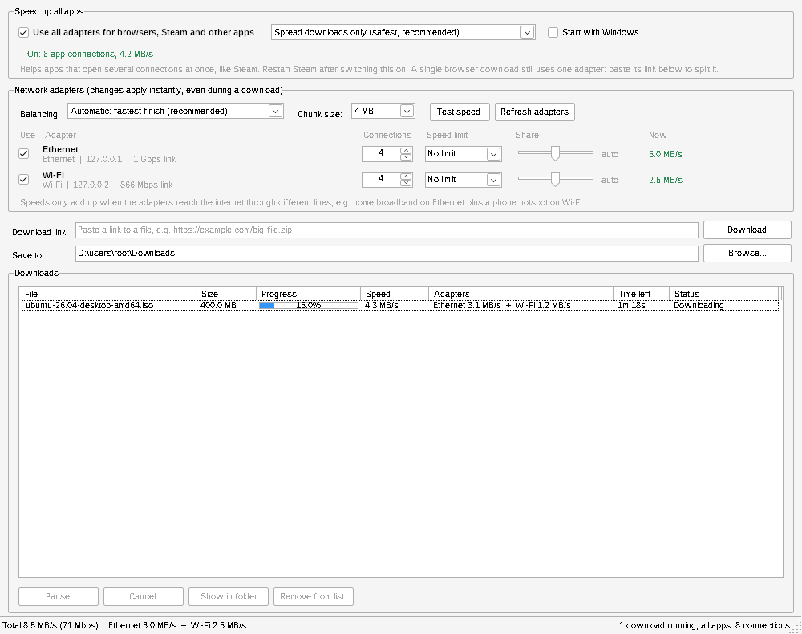

# Download Faster

A Windows app that uses **Wi-Fi and Ethernet at the same time** so their speeds add up. It works two ways:

- **All apps (browsers, Steam, launchers):** tick one box and apps that follow the Windows proxy setting send their connections out through all your adapters. Runs quietly in the notification area and can start with Windows.
- **Paste a link:** for one big file, the app splits it into pieces and downloads them over every adapter at once.

Everything is adjustable while it runs: turn adapters on or off, cap their speed, give each one a fixed share, and choose how freely app traffic is spread.



<sub>Screenshot from a test run with simulated adapters on a local server, which is why the addresses are 127.0.0.x.</sub>

## Will it actually be faster?

The speeds add up when **the two adapters reach the internet through different lines**, for example:

- home broadband on Ethernet + a phone hotspot or a second network on Wi-Fi
- office network on Ethernet + guest Wi-Fi on a separate connection
- an internet plan faster than either link alone (e.g. 2 Gbps fibre with a 1 Gbps Ethernet port, and Wi-Fi 6 to the same router)

If Wi-Fi and Ethernet both go to the same router on the same internet line, that line is the limit and combining them gains little. Click **Test speed** to find out: it measures each adapter alone, then all together, and tells you whether you gain anything.

What gets faster in **all-apps mode**: a single network connection always travels over one adapter (splitting one connection needs a server on the other end, which is what paid bonding services do). So all-apps mode helps apps that open **several connections at once**:

| App | Faster? |
| --- | --- |
| Steam, Epic and other game launchers | Yes. They download a game in many pieces over several connections. Restart Steam after turning the mode on. |
| Several downloads at once, Windows/app updates through apps that use the proxy | Yes |
| One big download in a browser | No, that is one connection. Paste its link into the app instead, which splits the file. |
| Normal browsing and video | Barely. Pages and streams are limited by delay or bitrate, not bandwidth. |
| Games while playing, voice and video calls | Not affected (they do not use the proxy). |

## Download

1. Open the [Actions tab](https://github.com/kseoluberkay/Download-Faster/actions/workflows/build.yml), pick the latest green run and download the **DownloadFaster-windows** artifact. (When a release is tagged, the files are also on the [Releases page](https://github.com/kseoluberkay/Download-Faster/releases).)
2. Unzip it and run `DownloadFaster-x64.exe` (most PCs) or `DownloadFaster-arm64.exe` (Snapdragon / Windows on ARM laptops).

It is a single portable `.exe`: no installer, no .NET install needed, no admin rights. Because the file is not code-signed, Windows SmartScreen may warn you the first time; click **More info > Run anyway**. Put it somewhere permanent (e.g. a `Tools` folder) before ticking **Start with Windows**.

Requires Windows 10 or 11.

## How to use

### All apps

1. Connect both Wi-Fi and Ethernet.
2. Tick **Use all adapters for browsers, Steam and other apps**. Optionally tick **Start with Windows**.
3. Restart Steam (and any launcher that was already open) so it picks up the new setting.

Closing the window keeps it running in the notification area; right-click the icon to open it or exit. Untick the box or exit the app and your previous Windows proxy settings come back exactly as they were. If the app ever crashes, a small watchdog restores them for you, and the next start checks again.

**How freely app traffic is spread:**

| Option | What it does |
| --- | --- |
| **Spread downloads only** (default, safest) | Game and update downloads (Steam, Epic, GOG, Blizzard, Windows Update, GitHub and any unencrypted HTTP download) use every adapter. All other sites stay on one adapter, so logins, banking and video sites never see your address change. |
| **Keep each website on one adapter** | Different sites use different adapters, but each site always sees the same address. |
| **Spread every connection** | Fastest. Some sites may log you out or refuse videos because your address keeps changing. |

### Paste a link

1. Paste a download link (the app offers a copied link automatically) and press **Enter** or **Download**.
2. Watch the live speed per adapter in the **Now** column and in the status bar.

Pause, resume, cancel, open the file or show it in its folder from the buttons or the right-click menu. Unfinished downloads come back as paused next time and continue where they stopped.

## Settings

Everything below applies instantly, also to downloads and connections that are already running, and is remembered between runs.

| Setting | What it does |
| --- | --- |
| **Use** | Include or exclude an adapter. Unticking one mid-download hands its work to the others. |
| **Connections** | Parallel connections per adapter for pasted links (1-32). 4-8 is usually plenty. Other apps choose their own number. |
| **Speed limit** | Caps an adapter for everything, e.g. to spare a metered hotspot. Pick a value or type any number of MB/s (1 MB/s = 8 Mbps). |
| **Balancing: Automatic** (default) | Faster adapters automatically take more of the work. |
| **Balancing: Fixed split** | Each adapter gets the share you set with its **Share** slider, e.g. 80% Ethernet / 20% Wi-Fi, for both pasted links and app connections. |
| **Chunk size** | Size of the pieces a pasted download is cut into (1-32 MB). |
| **Test speed** | Measures each ticked adapter alone, then together. |
| **Refresh adapters** | Re-scan now. The app also re-scans by itself when a cable or network changes. |

Advanced options live in `%LOCALAPPDATA%\DownloadFaster\settings.json`: `ProxyPort` (default 48842), `ExtraDownloadHosts` (more sites to treat as pure download servers) and `SpeedTestUrl`.

## How it works

- **Adapter binding.** Every outgoing connection is bound to one adapter's IP address before it connects. Windows sends traffic out of the adapter that owns the source address, so connections bound to the Wi-Fi address use Wi-Fi and the others use Ethernet.
- **All-apps mode** runs a small proxy on `127.0.0.1` (HTTP, HTTPS via CONNECT, SOCKS5 and SOCKS4a, reachable only from this PC) and points the Windows proxy setting at it. For each new connection it picks the adapter with the fewest open connections (weighted by the Share sliders in fixed-split mode), keeps sites on one adapter according to the spread option, and falls back to another adapter, and finally to a normal connection, if one cannot connect. Local network addresses bypass it. Encrypted traffic is passed through untouched; the app never decrypts anything.
- **Pasted links** are cut into chunks and fetched with HTTP range requests. Connections on every adapter take chunks from one shared queue. When the queue is empty, an idle connection splits the biggest unfinished chunk in proportion to the two connections' speeds, so a slow adapter never holds up the last few percent.
- **Resilience.** Dropped connections are retried, an adapter that keeps failing (e.g. Wi-Fi with no internet) is backed off while the others carry on, and partial downloads are resumable after a pause, crash or reboot. Servers without range support still work over one connection.

## Limitations

- All-apps mode only affects apps that use the Windows proxy setting. Browsers (Chrome, Edge, Firefox by default) and, by user reports, Steam do; some games and launchers ignore it, and those simply keep working as before.
- Microsoft Store apps are not allowed to reach a proxy on the same PC, so while all-apps mode is on they may say they are offline. Untick the mode while you use them (or see below).
- Corporate networks that need their own proxy are bypassed by all-apps mode; leave it off there.
- Pasted links must be direct HTTP/HTTPS file links; links that need you to be logged in will not work.

## Troubleshooting

**Wi-Fi disconnects when Ethernet is plugged in.** Windows can be set to "minimize simultaneous connections". To allow both, run this in an admin Command Prompt and restart:

```
reg add "HKLM\SOFTWARE\Policies\Microsoft\Windows\WcmSvc\GroupPolicy" /v fMinimizeConnections /t REG_DWORD /d 0 /f
```

(Same setting in Group Policy: Computer Configuration > Administrative Templates > Network > Windows Connection Manager > *Minimize the number of simultaneous connections to the Internet or a Windows Domain* > Enabled, option 0.) Delete the value again to undo it.

**Steam does not get faster.** Restart Steam after turning all-apps mode on, and check that the adapters' **Now** column moves while Steam downloads. If it stays at zero, your Steam install is ignoring the Windows proxy setting.

**A Microsoft Store app cannot connect.** Untick all-apps mode while using it. To let one app through permanently, allow it to reach this PC from an admin Command Prompt, e.g. for the Store itself: `CheckNetIsolation LoopbackExempt -a -n=Microsoft.WindowsStore_8wekyb3d8bbwe`.

**No internet after deleting the app while all-apps mode was on.** Open Settings > Network & internet > Proxy and turn off **Use a proxy server**. (Normally the app restores this itself; it only stays behind if the app is deleted while running.)

**An adapter shows "Problem, retrying".** Hover over it to see the error. Usually that network has no internet access (captive portal, hotspot out of data). Untick it, or fix the connection and it rejoins on its own.

**An adapter is missing.** Only connected adapters with an internet gateway are listed. VPN and virtual adapters are listed but unticked by default.

## Build from source

Needs the [.NET 10 SDK](https://dotnet.microsoft.com/download/dotnet/10.0).

```
dotnet test                                                    # engine and proxy tests
dotnet run --project src/DownloadFaster.App                    # run the app (Windows)
dotnet publish src/DownloadFaster.App -c Release -r win-x64    # single DownloadFaster.exe
```

The app only runs on Windows, but everything builds and the tests run on Linux and macOS too. The tests use local servers and bind to `127.0.0.1` and `127.0.0.2` to stand in for two adapters.

| Folder | Contents |
| --- | --- |
| `src/DownloadFaster.Core` | Engine: adapter discovery, bound connections, split downloads, speed limits, resume, and the all-apps proxy (`Proxy/`). No UI code. |
| `src/DownloadFaster.App` | Windows Forms app, notification-area icon, Windows proxy guard and watchdog. |
| `tests/DownloadFaster.Core.Tests` | End-to-end tests against local servers. |
